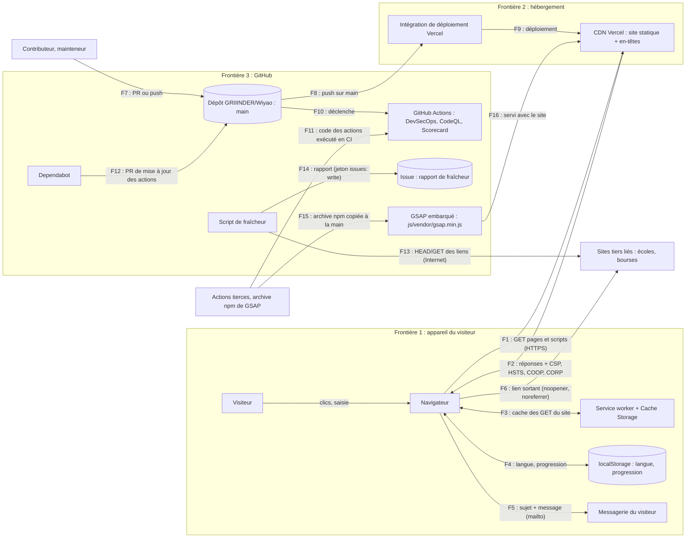

# Modèle de menaces WIYAO

| | |
|---|---|
| **Commit audité** | `1f4ccf591e6497d0fee7862cc57c8ec109275969`, déployé en production le 2026-11-03 à 23 h 42 (UTC) |
| **Date de l'audit** | 2026-11-04 |
| **Méthodes** | PASTA (cadre de risque), STRIDE par élément (menaces), [OWASP Top 10:2025](owasp-top10.md) (liste de contrôle croisée) |
| **Constats** | [findings.md](findings.md) |
| **Périmètre** | celui de [`SECURITY.md`](../../SECURITY.md) |

## Quand mettre ce document à jour

Ce modèle décrit l'état du commit audité. Une PR qui change une **frontière de confiance** doit le mettre à jour dans le même changement :

- un nouvel appel réseau (vers le site ou vers un autre domaine) ;
- un nouveau tiers : script, police, API, outil de mesure, service de formulaire ;
- un nouveau workflow GitHub Actions, ou une nouvelle permission ou un nouveau secret dans un workflow existant ;
- une nouvelle donnée stockée dans le navigateur ou envoyée hors du navigateur ;
- un changement de la configuration de déploiement (`vercel.json`) ou du service worker (`sw.js`).

## Échelle de gravité

La gravité combine la probabilité (qui peut le faire, avec quel effort) et l'impact sur les objectifs de l'étape 1. Une fausse information publiée compte comme l'impact le plus grave, car elle peut orienter la décision d'un bachelier.

| Gravité | Signification |
|---|---|
| **Critique** | Exploitable sans accès particulier ; altère le contenu publié, exécute du code chez les visiteurs ou expose des données personnelles. |
| **Élevée** | Même impact, mais il faut une condition peu coûteuse (une PR acceptée sans relecture attentive, un lien piégé ouvert par le visiteur). |
| **Moyenne** | Impact partiel (une partie des visiteurs, une fonction) ou condition coûteuse (compromission d'un compte ou d'un tiers de confiance). |
| **Faible** | Impact mineur ou théorique ; défense en profondeur. |
| **Info** | Observation sans risque direct, consignée pour mémoire. |

---

## Étape 1 : objectifs métier et actifs

WIYAO accompagne le bachelier togolais dans son orientation tech. C'est un site statique, sans compte ni serveur applicatif.

| Objectif | Actif protégé | Ce qui le menace |
|---|---|---|
| **O1. Information fiable** (objectif principal) | Contenu publié : frais, dates, bourses, écoles, liens d'inscription (`js/data.js`, pages HTML) | Altération du contenu ou d'un lien, publication d'une fausse information, redirection vers un site piégé |
| **O2. Site disponible**, y compris hors ligne et sur les connexions lentes | Pages, scripts, cache du service worker | Panne, cache corrompu, script qui casse l'affichage chez une partie des visiteurs |
| **O3. Aucune collecte de données** | Ce que le visiteur saisit (formulaires Contact et Proposer), sa progression et sa langue (`localStorage`) | Fuite vers un serveur ou un tiers, données personnelles dans une adresse, traceur |
| **O4. Confiance dans la marque** | Nom WIYAO, domaine `wiyao.vercel.app`, dépôt public | Défiguration, contenu malveillant servi sous le nom du site |

## Étape 2 : périmètre technique

**Dans le périmètre** :
- les 20 pages HTML, `css/`, `fonts/`, `icons/`, `manifest.json` ;
- `js/app.js`, `nav.js`, `i18n.js`, `assistant.js`, `anim.js`, `data.js` et `js/vendor/gsap.min.js` (GSAP 3.15.0) ;
- `sw.js` (service worker), `vercel.json` (en-têtes et CSP) ;
- les workflows `.github/workflows/*` : DevSecOps, CodeQL, Scorecard, fraîcheur ;
- `scripts/check-freshness.js` et les scripts de CI ;
- Dependabot, `SECURITY.md`, `.well-known/security.txt`.

**Hors périmètre** :
- les sites tiers liés (écoles, bourses, employeurs) ;
- le phishing ciblant les mainteneurs ;
- les dénis de service volumétriques ;
- la sécurité interne de Vercel et de GitHub.

**Hypothèses de confiance**, posées mais non vérifiées par cet audit :
1. Vercel sert fidèlement le dernier déploiement de `main` et applique `vercel.json`.
2. GitHub protège le dépôt, les jetons et l'exécution des Actions.
3. Les deux comptes qui peuvent pousser sur `main` (GRIIINDER, administrateur ; Ouraking, écriture) sont protégés par une authentification à deux facteurs.
4. Le registre npm a publié la vraie archive de GSAP 3.15.0. Son empreinte `integrity` a été vérifiée, voir l'étape 5.

## Étape 3 : décomposition et flux de données

| Flux | Données | Frontière franchie |
|---|---|---|
| F1, F2 | Pages, scripts, `data.js` ; aucune donnée du visiteur, pas de cookie | Internet ↔ site |
| F3 | Copies des réponses `GET` du site ; jamais une page HTML avec paramètres | Interne à l'appareil |
| F4 | `wiyao-lang` (`fr`/`en`), `wiyao-progress` (étapes cochées) | Interne à l'appareil |
| F5 | Nom, e-mail, sujet, message, remis à l'application de messagerie | Site ↔ messagerie : le site n'envoie rien lui-même |
| F6 | Navigation vers un autre domaine, sans `Referer` ni `window.opener` | Site ↔ tiers |
| F7 | Code et contenu (y compris `data.js`) | Contributeur ↔ dépôt |
| F8, F9 | Contenu complet du site ; aucune vérification CI obligatoire avant déploiement | GitHub ↔ Vercel |
| F10, F11 | Code des actions tierces, exécuté avec les permissions de chaque tâche | Tiers ↔ CI |
| F15, F16 | Bibliothèque GSAP : copiée depuis l'archive npm, puis servie comme un fichier du site (même origine) | Tiers ↔ dépôt |
| F13 | Requêtes sortantes du runner vers chaque lien du site | Runner ↔ Internet |
| F14 | Liste de liens et statuts HTTP, publiée dans une issue publique | CI ↔ dépôt public |

---

## Étape 4 : menaces (STRIDE par élément)

Pour chaque élément : **S** usurpation, **T** altération, **R** répudiation, **I** divulgation d'informations, **D** déni de service, **E** élévation de privilèges. Les identifiants `WIY-SEC-NNN` renvoient au [registre](findings.md).

### E1. Navigateur du visiteur (pages et scripts du site)

- **S** : une page tierce se fait passer pour WIYAO en l'affichant dans un cadre. *Mitigation* : `X-Frame-Options: DENY` et `frame-ancestors 'none'` (`vercel.json`).
- **T** : une donnée de contenu contient du HTML ou un lien `javascript:` et exécute du code (XSS stockée). *Mitigation* : `escapeHtml()` et `safeUrl()` dans `app.js`, notes en `textContent` (PR #8), CSP `script-src 'self'` plus empreinte, `object-src 'none'`. Prouvé par injection dans le navigateur (étape 5, WIY-SEC-002 et WIY-SEC-003).
- **R** : sans objet. Le site ne reçoit aucune action du visiteur à attribuer.
- **I** : la page d'origine fuit vers un site tiers ouvert depuis WIYAO. *Mitigation* : `rel="noopener noreferrer"` sur les liens créés à partir des données, `Referrer-Policy: strict-origin-when-cross-origin` ailleurs. Les liens écrits en dur dans les pages gardent `noopener` seul : seule l'origine est transmise.
- **D** : un script casse l'affichage chez une partie des visiteurs. *Constat* : avec le stockage bloqué, catalogue, test et calendrier ne s'affichaient plus (**WIY-SEC-006**, corrigé par cet audit).
- **E** : une page tierce ouverte depuis WIYAO agit sur la fenêtre d'origine (*reverse tabnabbing*). *Mitigation* : `noopener`, `Cross-Origin-Opener-Policy: same-origin`.

### E2. CDN Vercel (site statique et en-têtes)

- **S** : un faux site imite WIYAO, par exemple sur un sous-domaine voisin de `vercel.app`. Ce risque est hors périmètre (phishing) ; la seule adresse officielle est celle de `security.txt` et du `README`.
- **T** : un intermédiaire modifie les pages en transit. *Mitigation* : HTTPS imposé, `Strict-Transport-Security` sur 2 ans, `upgrade-insecure-requests`.
- **R** : la journalisation est assurée par Vercel, hors de notre contrôle (hypothèse de confiance 1).
- **I** : `Access-Control-Allow-Origin: *`, envoyé par défaut par Vercel, permet à n'importe quel site de lire les pages par `fetch`. Les pages étant publiques et sans cookie, rien de privé n'est exposé (**WIY-SEC-011**, accepté).
- **D** : panne de Vercel. C'est un risque de dépendance, hors périmètre ; le service worker garde le site lisible hors ligne.
- **E** : sans objet. Aucune fonction serveur ni zone d'administration n'est servie.

### E3. Service worker et Cache Storage

- **S** : un script d'une autre origine enregistre un service worker sur le domaine. *Mitigation* : seul `sw.js`, servi par le site, peut s'enregistrer (même origine) ; `worker-src 'self'`.
- **T** : le cache conserve une version compromise après correction (cache empoisonné). *Mitigation* : la stratégie « stale-while-revalidate » revalide à chaque visite, et `CACHE_NAME` est changé à chaque déploiement. Le risque résiduel est un chargement en retard (comportement connu, voir CLAUDE.md).
- **R** : sans objet.
- **I** : une page avec des données personnelles dans son adresse reste en cache. *Mitigation* : aucune page HTML avec paramètres n'est mise en cache (PR #8, WIY-SEC-004). Vérifié dans le navigateur.
- **D** : un cache plein ou corrompu bloque le site. *Mitigation* : seules les réponses `ok` sont mises en cache, et le réseau prend le relais.
- **E** : sans objet. Le service worker n'intercepte que les `GET` du site.

### E4. `localStorage`

- **S** : sans objet. Aucune identité n'est stockée.
- **T** : une valeur corrompue (`__proto__`, mauvais type) pollue les objets ou casse la page. *Mitigation* : la progression est chargée dans un `Map` et la langue comparée strictement à `"en"`. Vérifié : pas de pollution du prototype. Une valeur de mauvais type provoquait une erreur au clic sur une case (**WIY-SEC-013**, info, corrigé par cet audit ; seul le visiteur peut écrire dans son propre stockage).
- **R** : sans objet.
- **I** : la progression est lisible par un autre site. *Mitigation* : le stockage est cloisonné par origine ; il ne contient ni nom ni e-mail.
- **D** : stockage refusé par le navigateur → **WIY-SEC-006** (corrigé : le site s'affiche sans mémoriser langue ni progression).
- **E** : sans objet.

### E5. Passage à la messagerie (`mailto:`)

- **S** : le formulaire envoie vers une autre adresse que celle de WIYAO. *Mitigation* : adresse écrite en dur dans `app.js` et dans `action`, `form-action 'self' mailto:`.
- **T** : une injection d'en-têtes dans le lien `mailto:` ajoute un destinataire. *Mitigation* : sujet et corps passent par `encodeURIComponent`.
- **R** : hors de notre contrôle. C'est la messagerie du visiteur qui envoie, sous son identité.
- **I** : nom et e-mail se retrouvent dans l'adresse d'une page ou chez un serveur. *Mitigation* : le repli sans JavaScript passe en `POST` vers `mailto:` en `text/plain` (PR #8, WIY-SEC-004), et aucun envoi vers un serveur n'est possible (`form-action`).
- **D** : sans objet.
- **E** : sans objet.

### E6. Dépôt GitHub (branche `main`)

- **S** : un attaquant pousse au nom d'un mainteneur, avec un compte ou un jeton volé. *Constat* : aucune protection de branche, et un push sur `main` est déployé sans vérification obligatoire (**WIY-SEC-007**, accepté avec réexamen).
- **T** : une PR modifie `data.js` (faux frais, lien piégé) ou `js/vendor/gsap.min.js`. *Mitigation* : relecture humaine, Gitleaks, CodeQL, et l'encodage côté navigateur limite l'impact à du texte. Contrôle d'intégrité de GSAP ajouté en CI (WIY-SEC-010). Le risque résiduel de fausse information acceptée en relecture relève de la règle « contenu vérifié » de CLAUDE.md.
- **R** : les commits poussés en ligne de commande ne sont pas signés (seules les fusions faites sur GitHub le sont) : un auteur pourrait nier un commit. L'historique Git et le journal d'audit GitHub suffisent pour un projet de cette taille (info, intégré à WIY-SEC-007).
- **I** : un secret est commis dans le dépôt public. *Mitigation* : Gitleaks sur chaque PR et chaque push, sur tout l'historique.
- **D** : suppression de branche ou force-push. *Mitigation* : CLAUDE.md interdit le force-push sans demande ; aucune règle technique ne l'interdit (WIY-SEC-007).
- **E** : un contributeur externe obtient les droits d'écriture. Seuls deux comptes les ont (hypothèse de confiance 3).

### E7. GitHub Actions (DevSecOps, CodeQL, Scorecard)

- **S** : une action tierce est remplacée par une version malveillante sous la même étiquette. *Mitigation* : chaque action est épinglée sur un SHA de 40 caractères (contrôle d'hygiène), Dependabot les met à jour avec un délai de 7 jours, le binaire Gitleaks est vérifié par empreinte.
- **T** : une PR modifie un workflow pour exfiltrer un jeton. *Mitigation* : aucun `pull_request_target` ni `workflow_run`, pas d'interpolation de `github.event` dans des commandes, `persist-credentials: false`, zizmor bloquant à partir de la gravité moyenne.
- **R** : journal des exécutions GitHub.
- **I** : un jeton fuite dans un journal. *Mitigation* : `GITHUB_TOKEN` n'est passé qu'à l'étape qui publie l'issue, `harden-runner` sur les tâches DevSecOps.
- **D** : une CI bloquée empêche une correction. Les contrôles ne sont pas obligatoires pour fusionner (WIY-SEC-007), donc une correction urgente reste possible.
- **E** : une tâche obtient plus de droits que nécessaire. *Mitigation* : `permissions: {}` (ou `read-all`) au niveau de chaque workflow. Écritures accordées et justifiées : `security-events: write` (envoi SARIF de CodeQL, Trivy et Scorecard), `id-token: write` (publication Scorecard), `issues: write` (rapport de fraîcheur). Exigence vérifiée en CI (WIY-SEC-010).

### E8. Script de fraîcheur (`scripts/check-freshness.js`)

- **S** : sans objet.
- **T** : un lien du site redirige le runner vers une adresse interne (SSRF). *Mitigation* : `net.BlockList` (y compris les formes IPv6 `::ffff:`), redirections suivies à la main et revérifiées (PR #8, WIY-SEC-001). Risque résiduel : un DNS piégé peut répondre différemment entre la vérification et la requête (**WIY-SEC-014**, accepté).
- **R** : l'issue garde l'historique des rapports.
- **I** : le rapport public révèle un lien interne. *Mitigation* : les adresses privées ne sont jamais contactées, et seul un lien déjà publié sur le site peut figurer dans le rapport.
- **D** : un lien très lent épuise le temps d'exécution. *Mitigation* : 10 s par lien, 8 en parallèle, 15 min par tâche.
- **E** : le runtime n'est plus maintenu → **WIY-SEC-009** (Node 20 en fin de vie depuis le 2026-04-30 ; corrigé, Node 24).

### E9. Intégration de déploiement Vercel

- **S** : une PR d'un dépôt dérivé déclenche un déploiement de prévisualisation sous le nom du projet. Le réglage de protection des dépôts dérivés n'a pas pu être vérifié depuis cet audit, faute d'accès au tableau de bord Vercel (**WIY-SEC-015**, à confirmer).
- **T** : un push non relu part en production → WIY-SEC-007.
- **R** : historique des déploiements (environnements « Preview » et « Production » de GitHub).
- **I** : une variable d'environnement fuite dans un déploiement. Sans objet : le site n'en utilise aucune.
- **D** : un déploiement cassé. *Mitigation* : la fonction de retour arrière de Vercel ramène le déploiement précédent.
- **E** : sans objet. Aucune fonction serveur n'est déployée.

### E10. GSAP embarqué (`js/vendor/gsap.min.js`)

- **S** : un faux GSAP est copié à la place de l'officiel. *Mitigation* : la version déployée est identique, octet pour octet, au fichier de l'archive npm `gsap@3.15.0`, dont l'empreinte `integrity` (sha512) a été vérifiée (étape 5).
- **T** : une PR modifie le fichier. *Mitigation* : empreinte SHA-256 de référence vérifiée en CI (WIY-SEC-010).
- **R** : sans objet.
- **I** : GSAP envoie des données à un tiers. *Mitigation* : la CSP `connect-src 'self'` bloque tout envoi vers un autre domaine.
- **D** : GSAP ne se charge pas. *Mitigation* : tout le contenu reste affiché sans animation (règle de CLAUDE.md).
- **E** : sans objet.

---

## Étape 5 : faiblesses

Les faiblesses sont relevées par catégorie dans [owasp-top10.md](owasp-top10.md). Les vérifications concrètes qui fondent ce modèle :

- **Injection dans le navigateur** : une copie de `data.js` a été modifiée à la volée (interception Playwright). Elle plaçait `` dans un nom d'école, ses frais, ses villes, ses filières et ses dates, dans une note de communauté, une question du test, un titre de roadmap et le calendrier, ainsi que des liens `javascript:`.
  - Pages visitées : Écoles, Calendrier, Roadmaps, roadmap `cyber`, Test, Recherche.
  - Résultat : 0 exécution, 0 boîte de dialogue, 0 lien `javascript:`, 0 `` injecté. La charge s'affiche comme du texte.
- **Insertions de HTML restantes** (`i18n.js` l. 1667, `nav.js` l. 220, 473 et 487, squelette de l'assistant) : elles n'insèrent que des chaînes écrites dans le code du site. La fenêtre légale lit 4 pages fixes du site (`TABS`) et retire leurs `<script>`.
- **Stockage refusé** : simulé en faisant lever `SecurityError` à `window.localStorage`.
  - Résultat : 0 carte de roadmap, 0 fiche école, 0 question, 0 date, 0 étape de roadmap affichées.
  - Cause : `app.js` et `i18n.js` lisent `localStorage` sans `try`.
- **GSAP** : la version du dépôt (forme LF, telle que servie) a l'empreinte SHA-256 `92bb9a96476f983d212a2bc4f54c889039c1696dd4461d40a736860938570fbb`, identique au fichier de l'archive npm. L'archive correspond à son `integrity` publié : `sha512-dMW4CWBTUK1AEEDeZc1g4xpPGIrSf9fJF960qbTZmN/QwZIWY5wgliS6JWl9/25fpTGJrMRtSjGtOmPnfjZB+A==`.
- **Dépôt** : 2 comptes peuvent pousser, aucune règle de branche (API `branches/main/protection` : 404 ; `rulesets` : 0), signalement privé de vulnérabilités désactivé (WIY-SEC-008).

## Étape 6 : scénarios d'attaque

| # | Scénario | Menace (étape 4) | Faiblesse (étape 5) | Résultat au commit audité |
|---|---|---|---|---|
| A1 | Un contributeur ouvre une PR qui change le lien d'inscription d'une école vers un site de phishing, ou des frais erronés. | E6-T | Relecture humaine seule pour le sens du contenu | Possible si la relecture laisse passer : aucune défense technique ne juge le sens d'une donnée. Règle « contenu vérifié » de CLAUDE.md. |
| A2 | La même PR glisse `` ou un lien `javascript:` dans `data.js`. | E1-T, E6-T | Encodage avant la PR #8 | Bloqué : texte affiché, lien refusé (WIY-SEC-002 et 003, corrigés). |
| A3 | Une PR remplace `js/vendor/gsap.min.js` par une version piégée qui lit la progression ou redirige le visiteur. | E10-T | Aucun contrôle d'intégrité avant cet audit | Désormais bloqué en CI (WIY-SEC-010). La CSP limiterait déjà l'exfiltration à l'origine du site. |
| A4 | Un site lié répond par une redirection vers `http://[::ffff:a9fe:a9fe]/` (métadonnées cloud) au passage du script de fraîcheur. | E8-T | Garde SSRF contournable (PR #2) | Bloqué : l'adresse n'est jamais contactée (WIY-SEC-001). |
| A5 | Un jeton d'un mainteneur fuit ; l'attaquant pousse sur `main` une page qui annonce de fausses dates de concours. | E6-S, E9-T | Pas de protection de branche, déploiement automatique | Possible, publié en quelques minutes ; détecté seulement par un humain (WIY-SEC-007, WIY-SEC-016). |
| A6 | Une action tierce épinglée est compromise chez son éditeur. | E7-S | — | Sans effet tant que le SHA épinglé ne change pas ; une mise à jour Dependabot passe par une PR relue, avec 7 jours de délai. |
| A7 | Un visiteur bloque les données des sites ; le catalogue disparaît et il conclut que le site est vide. | E1-D, E4-D | `localStorage` lu sans `try` | Possible pour tous ces visiteurs au commit audité ; corrigé par cet audit (WIY-SEC-006). |

## Étape 7 : risques et impact

| Scénario | Objectif touché | Probabilité | Impact | Gravité | Constat |
|---|---|---|---|---|---|
| A5 | O1, O4 | Faible : vol d'un compte protégé par 2FA | Fausse information publiée sous le nom de WIYAO | **Moyenne** | WIY-SEC-007 (accepté, réexamen le 2027-02-04) |
| A7 | O2 | Moyenne : réglage courant chez les visiteurs soucieux de leur vie privée | Contenu principal invisible pour ces visiteurs | **Moyenne** | WIY-SEC-006 |
| A1 | O1 | Moyenne | Fausse information publiée | **Moyenne** (résiduel, maîtrisé par la règle « contenu vérifié ») | intégré à WIY-SEC-007 |
| A3 | O1, O3 | Faible | Code exécuté chez tous les visiteurs | **Faible** (après contrôle CI) | WIY-SEC-010 |
| A2, A4, A6 | O1, O3 | Faible | — | **Faible** (déjà bloqués) | WIY-SEC-001 à 003 |

Aucun scénario n'atteint la gravité critique ou élevée au commit audité. Les constats corrigés par la PR #8 étaient de gravité moyenne avant correction.
